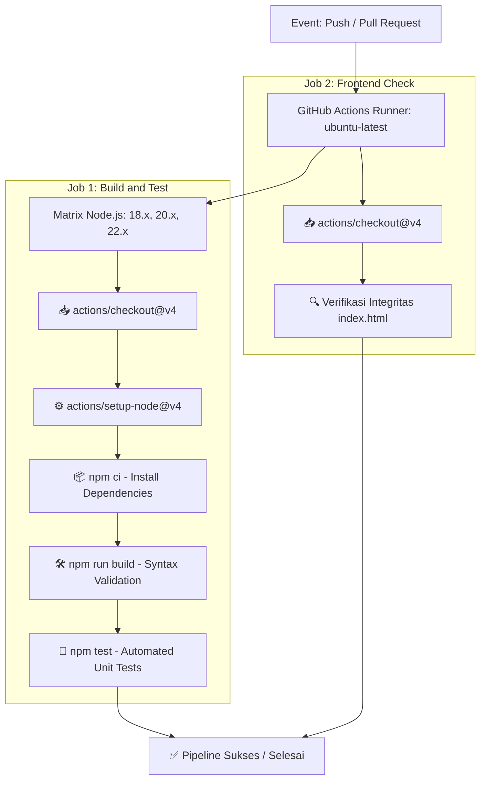
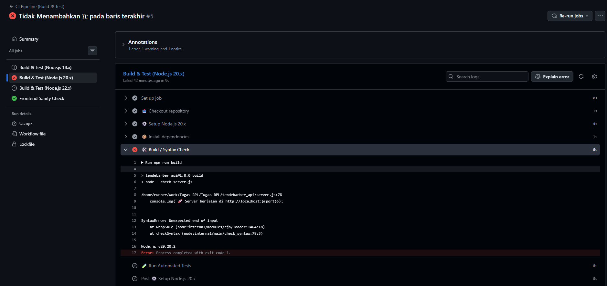
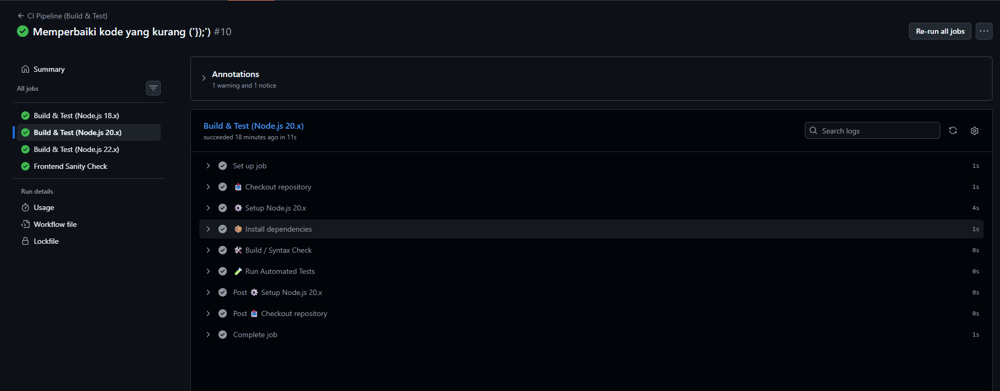
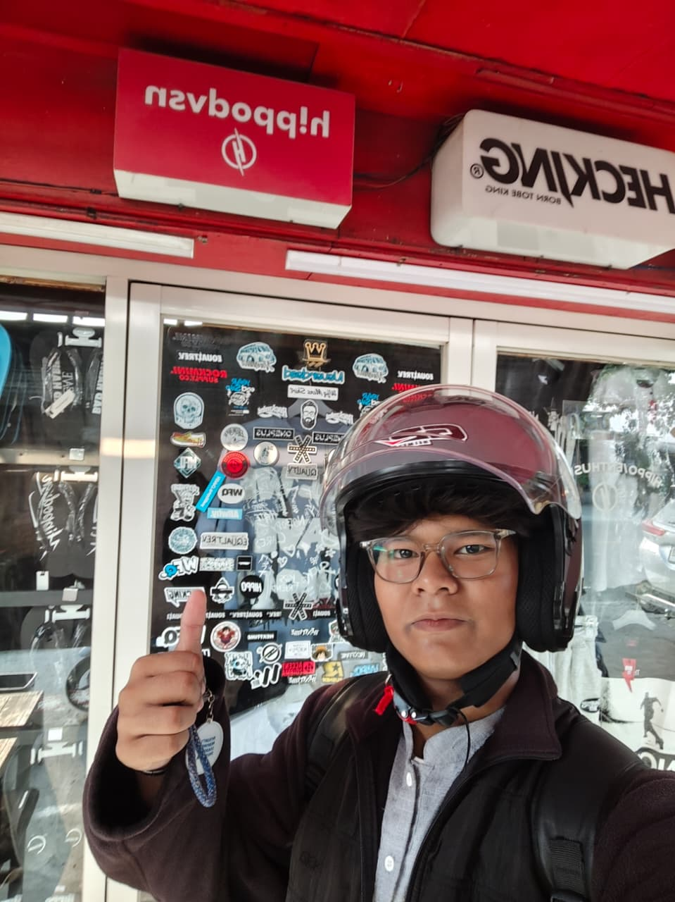

# 💈 TENDEBARBER - Digital POS & ERP System
> **Team-Based Project (TBP) — Rekayasa Perangkat Lunak (RPL)**  
> **Program Studi S1 Teknik Informatika — Universitas Tadulako**

[](https://github.com/Raehan-tu/Tugas-RPL/actions/workflows/ci.yml)


---

## 📌 Daftar Isi
- [Tentang Proyek](#-tentang-proyek)
- [Arsitektur & Struktur Direktori](#-arsitektur--struktur-direktori)
- [Panduan Menjalankan Sistem Secara Lokal](#-panduan-menjalankan-sistem-secara-lokal)
- [Implementasi CI Pipeline (GitHub Actions)](#-implementasi-ci-pipeline-github-actions)
- [Bukti Eksekusi Pipeline (Kasus Gagal vs Sukses)](#-bukti-eksekusi-pipeline-kasus-gagal-vs-sukses)
  - [1. Kasus Pipeline Gagal (Failed Run)](#1-kasus-pipeline-gagal-failed-run-)
  - [2. Kasus Pipeline Sukses (Success Run)](#2-kasus-pipeline-sukses-success-run-)
- [Ringkasan Error & Solusi Perbaikan](#-ringkasan-error--solusi-perbaikan)
- [Pembagian Peran & Tanggung Jawab Tim](#-pembagian-peran--tanggung-jawab-tim)

---

## 📖 Tentang Proyek

**TENDEBARBER** adalah sistem Point of Sale (POS) dan Enterprise Resource Planning (ERP) berbasis web modern yang dirancang untuk mengotomasi operasional bisnis barbershop. Sistem ini mempermudah pencatatan transaksi kasir harian, manajemen layanan potongan rambut, perhitungan bagi hasil/komisi kapster secara otomatis, serta rekapitulasi data keuangan.

### ✨ Fitur Utama:
1. **Digital POS Kasir**: Antarmuka kasir cepat untuk pemilihan layanan, diskon, dan metode pembayaran.
2. **Manajemen Kapster**: Pelacakan status aktif kapster dan kalkulasi komisi otomatis.
3. **Pencatatan Transaksi Real-time**: Terhubung ke database relasional MySQL melalui Express REST API.
4. **Automated CI/CD**: Pengujian otomatis dan integrasi berkelanjutan menggunakan GitHub Actions.

---

## 📂 Arsitektur & Struktur Direktori

```text
TUBESRPL/
├── .github/
│   └── workflows/
│       └── ci.yml             # Konfigurasi pipeline CI GitHub Actions
├── foto/                      # Aset gambar profil anggota tim
│   ├── cutsafira1.jpeg
│   ├── fiviandwiintan.jpeg
│   └── raehanhamdani.jpeg
├── tendebarber_api/           # Modul Backend (Node.js & Express)
│   ├── test/
│   │   └── server.test.js     # Skrip pengujian otomatis (Node native test runner)
│   ├── node_modules/          # Dependensi npm (diabaikan oleh git)
│   ├── package.json           # Metadata proyek, dependencies, & build/test script
│   ├── package-lock.json      # Dependency lockfile
│   └── server.js              # Server REST API & konfigurasi MySQL
├── .gitignore                 # Konfigurasi pengabaian file Git
├── index.html                 # Antarmuka Pengguna Frontend (Tailwind CSS SPA)
└── README.md                  # Dokumentasi resmi proyek dan luaran tugas
```

---

## 💻 Panduan Menjalankan Sistem Secara Lokal

Ikuti langkah-langkah di bawah ini untuk menguji instalasi, proses build, serta automated test di komputer lokal sebelum melakukan commit ke GitHub:

### 1. Prasyarat Lingkungan
* **Node.js**: Versi `>= 18.0.0` (disarankan Node.js 20 LTS atau 22).
* **Git**: Versi terbaru.
* **MySQL**: Versi 8.x (untuk koneksi database lokal).

### 2. Instalasi Dependensi
Buka terminal dan masuk ke direktori backend:
```bash
cd tendebarber_api
npm install
```

### 3. Eksekusi Build / Pemeriksaan Sintaks
Perintah ini memvalidasi seluruh sintaks JavaScript pada backend tanpa error:
```bash
npm run build
```

### 4. Eksekusi Pengujian Otomatis (Unit Test)
Perintah ini menjalankan seluruh unit test bawaan Node.js (`node:test`):
```bash
npm test
```
> **Output yang diharapkan:**
> ```text
> ✔ File server.js harus ada
> ✔ Syntax check: server.js harus valid tanpa error sintaks
> ✔ Package.json memiliki dependensi yang diperlukan
> ✔ Frontend index.html harus ada di root repository
> ℹ tests 4 | pass 4 | fail 0
> ```

### 5. Menjalankan Server Backend
```bash
npm start
```
Server akan aktif di `http://localhost:3000`. Buka file `index.html` pada browser untuk mengakses antarmuka POS.

---

## ⚙️ Implementasi CI Pipeline (GitHub Actions)

Alur kerja CI didefinisikan pada file [`.github/workflows/ci.yml`](.github/workflows/ci.yml). Pipeline ini dijalankan secara otomatis pada setiap aktivitas `push` ke semua branch, `pull_request`, maupun pemicu manual (`workflow_dispatch`).

### Matriks & Alur Kerja Pipeline:


1. **Multi-Version Matrix Testing**: Menjamin kompatibilitas backend di tiga versi Node.js berbeda (Node 18.x, 20.x, dan 22.x).
2. **Dependency Caching**: Memanfaatkan cache `npm` untuk mempercepat durasi build hingga < 30 detik.
3. **Automated Verification**: Memastikan backend valid dan berkas antarmuka frontend tidak hilang atau rusak.

---

## 📊 Bukti Eksekusi Pipeline (Kasus Gagal vs Sukses)

Sebagai pemenuhan luaran Tugas Team-Based Project (TBP), pipeline diuji dengan dua skenario:

### 1. Kasus Pipeline Gagal (Failed Run) ❌
* **Branch**: `Branch_Gagal`
* **Commit**: `Tidak Menambahkan }); pada baris terakhir`
* **Status**: **FAILED ❌**
* **Tautan Run Actions**: *[Lihat Run Gagal di GitHub Actions](https://github.com/Raehan-tu/Tugas-RPL/actions)*

> **Dokumentasi Tangkapan Layar (Gagal):**  
> *(Sertakan tangkapan layar status merah dari tab Actions repositori Anda di sini)*  
> 

---

### 2. Kasus Pipeline Sukses (Success Run) ✅
* **Branch**: `Branch_Berhasil`
* **Commit**: `ci: aktifkan trigger push untuk semua branch termasuk Branch_Berhasil`
* **Status**: **PASSED / SUCCESS ✅**
* **Tautan Run Actions**: *[Lihat Run Sukses di GitHub Actions](https://github.com/Raehan-tu/Tugas-RPL/actions)*

> **Dokumentasi Tangkapan Layar (Sukses):**  
> *(Sertakan tangkapan layar status centang hijau dari tab Actions repositori Anda di sini)*  
> 

---

## 🔍 Ringkasan Error & Solusi Perbaikan

| Parameter | Kasus Gagal (Sebelum Perbaikan) | Kasus Sukses (Setelah Perbaikan) |
| :--- | :--- | :--- |
| **Lokasi Berkas** | `tendebarber_api/server.js` | `tendebarber_api/server.js` |
| **Baris Kode** | Baris 77 - 79 | Baris 77 - 79 |
| **Bentuk Kode** | `// });` *(Kurung penutup dikomentari)* | `});` *(Sintaks ditutup dengan benar)* |
| **Pesan Error CI** | `SyntaxError: Unexpected end of input` | `tests 4 | pass 4 | fail 0` |
| **Tahapan Gagal** | Tahap `Build / Syntax Check` (`npm run build`) | Semua tahapan berhasil dilewati (*Green Check*) |
| **Trigger Branch** | Terbatas pada branch tertentu | `push:` dibuka universal ke seluruh branch |

---

## 👥 Pembagian Peran & Tanggung Jawab Tim

Pembagian tugas dalam penyelesaian Praktik Pipeline CI (Tugas Team-Based Project):

| Foto Profil | Data Anggota | Peran & Tanggung Jawab (Fokus Praktik CI) |
| :---: | :--- | :--- |
|  | **Raehan Hamdani**<br>*(Ketua Tim)* | • Membuat dan mengonfigurasi berkas workflow CI Pipeline (`.github/workflows/ci.yml`) untuk event push dan pull request.<br>• Menyiapkan perintah build dan automated test agar berjalan di lingkungan CI.<br>• Melakukan simulasi eksekusi kasus run gagal dan run sukses di GitHub Actions.<br>• Menyusun dokumentasi README untuk panduan menjalankan CI. |
|  | **Cut Safira**<br>*(Anggota Tim)* | • Menyusun laporan tugas Praktik Pipeline CI (Team-Based Project).<br>• Mengumpulkan dan mendokumentasikan bukti tangkapan layar (screenshot) hasil eksekusi run sukses dan gagal.<br>• Membantu penyusunan penjelasan alur kerja pipeline pada dokumen laporan. |
|  | **Fivian Dwi Intan**<br>*(Anggota Tim)* | • Menyusun laporan tugas Praktik Pipeline CI (Team-Based Project).<br>• Menyusun dokumentasi ringkasan error dan langkah-langkah perbaikan yang dilakukan.<br>• Memeriksa kelengkapan seluruh berkas luaran tugas sesuai kriteria penilaian. |

---

<div align="center">
  <sub>TENDEBARBER © 2026 — Dibuat untuk memenuhi Tugas Team-Based Project (TBP) Rekayasa Perangkat Lunak</sub>
</div>
